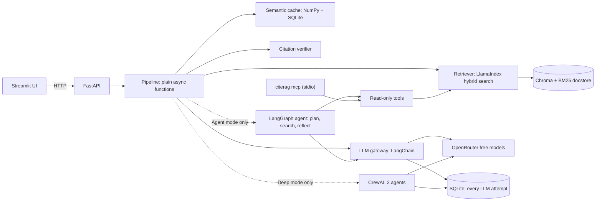

# CiteRAG

Ask questions about your own documents and get answers whose citations are checked by code, not trusted from the model. CiteRAG adds a semantic cache, image questions, a multi-agent Deep mode (CrewAI), an Agent mode that plans and searches with tools (LangGraph), an MCP server over the same read-only tools, and an evaluation harness.

Python only: FastAPI backend, Streamlit frontend, OpenRouter free models, local embeddings. It runs on one machine for one person. It is a practice project for phases 0 to 3 of a GenAI roadmap (see [Roadmap coverage](#roadmap-coverage)).

**Status:** milestones M0 to M12 are built and tested (669 tests, no network). Every quality number is PROVISIONAL until a human verifies the golden set: see [Results](#results-provisional), [Limitations](#limitations) and [the handoff](docs/results/HANDOFF.md). All docs are listed in [docs/results/INDEX.md](docs/results/INDEX.md).

## How it works



- **A question** is condensed if it is a follow-up, looked up in the cache, then answered from retrieved passages.
- **Citations are verified:** each quote is fuzzy-matched against its passage by code. A failure triggers one corrective retry, and any remaining doubt shows as a warning.
- **The cache** stores only fully verified answers, and any change to the corpus, answer model, prompt or retrieval settings invalidates it.
- **Document text is untrusted data.** It is escaped into a delimited block, and canary tests check that injected instructions are not followed.
- **Agent mode** splits a question into up to three sub-questions, searches each, checks whether the evidence is enough, and answers through the same verified path. Its trace shows every step and tool call.
- **The MCP server** offers three read-only tools (`list_documents`, `search_documents`, `read_page`) to any MCP client over stdio.

## Quickstart

You need [uv](https://docs.astral.sh/uv/), git and an [OpenRouter](https://openrouter.ai/) API key. Python 3.13 is installed by uv. The first `uv sync` downloads PyTorch, and the first ingest downloads the embedding model: allow 10 to 15 minutes and a few GB.

```bash
git clone https://github.com/f243077-cell/Cited-RAG-Project.git citerag
cd citerag
uv sync --extra dev
uv run pytest                              # no network, no key and no .env needed
cp .env.example .env                       # Windows: copy .env.example .env; then set OPENROUTER_API_KEY
uv run python scripts/fetch_sample.py      # optional: the public demo documents into data/sample
uv run citerag ingest data/sample          # local embeddings, zero LLM requests
uv run uvicorn citerag.api.main:app --port 8000
```

Without a key, the API still starts but answers every request with HTTP 503 and one clear line, for example `CiteRAG is not configured: missing OPENROUTER_API_KEY`. The CLI prints the same line and exits with code 2. The home page of the UI shows it.

In a second terminal:

```bash
uv run streamlit run src/citerag/ui/app.py
```

Open http://localhost:8501, go to Chat and ask a question. Upload your own files on the Library page.

**The semantic cache is off by default** (`CACHE_ENABLED=false`). `CACHE_THRESHOLD=0.92` is an unvalidated placeholder that can serve a wrong answer to a similar question. If you turn the cache on before a sweep on labelled pairs recommends your threshold, the API logs a warning and `/health` and the home page show it. Step 6 of [the handoff](docs/results/HANDOFF.md) validates it.

With Docker: `docker compose up --build` (backend on 127.0.0.1:8000, UI on 127.0.0.1:8501). Tested at the wind-up (2026-11-07): the image builds and both services start, `/health` and the UI answer, and the frontend holds no provider key. The image is about 21 GB because the lock file pulls CUDA-enabled PyTorch, so the first build takes about an hour.

## Configuration

Settings come from environment variables or `.env` (`config.py`). Names and defaults only; never commit `.env`. "required" settings have no code default: `.env.example` supplies them.

| Variable | Code default | `.env.example` |
|---|---|---|
| `OPENROUTER_API_KEY` | required | (your key) |
| `OPENROUTER_BASE_URL` | https://openrouter.ai/api/v1 | https://openrouter.ai/api/v1 |
| `OPENROUTER_REFERER` | http://localhost:8501 | http://localhost:8501 |
| `OPENROUTER_TITLE` | CiteRAG | CiteRAG |
| `OPENROUTER_REQUIRE_PARAMETERS` | true | true |
| `OPENROUTER_DATA_COLLECTION` | allow | allow |
| `GEMINI_API_KEY` | unset | empty |
| `GEMINI_BASE_URL` | https://generativelanguage.googleapis.com/v1beta/openai/ | https://generativelanguage.googleapis.com/v1beta/openai/ |
| `GEMINI_MAX_RPM` | 5 | 5 |
| `GEMINI_MAX_REQUESTS_PER_DAY` | 18 | 18 |
| `GEMINI_TIMEOUT_S` | 45 | 45 |
| `PROVIDER_FAST` | openrouter | openrouter |
| `PROVIDER_STRONG` | openrouter | openrouter |
| `PROVIDER_VISION` | openrouter | openrouter |
| `PROVIDER_JUDGE` | openrouter | openrouter |
| `MODEL_FAST` | required | nvidia/nemotron-3.5-super-vl:free |
| `MODEL_STRONG` | required | nvidia/nemotron-3.5-super-vl:free |
| `MODEL_VISION` | required | nvidia/nemotron-3.5-super-vl:free |
| `MODEL_JUDGE` | required | nvidia/nemotron-3.5-super-vl:free |
| `STRUCTURED_METHOD` | auto | auto |
| `LLM_TIMEOUT_S` | 60 | 60 |
| `LLM_MAX_RETRIES` | 2 | 2 |
| `LLM_MAX_TOKENS` | 2000 | 2000 |
| `LLM_TEMPERATURE` | unset | empty |
| `JUDGE_TEMPERATURE` | 0 | 0 |
| `LLM_MAX_RPM` | 15 | 15 |
| `MAX_REQUESTS_PER_DAY` | 40 | 40 |
| `EMBEDDING_MODEL` | BAAI/bge-small-en-v1.5 | BAAI/bge-small-en-v1.5 |
| `CHUNK_SIZE` | 512 | 512 |
| `CHUNK_OVERLAP` | 64 | 64 |
| `TOP_K_RETRIEVE` | 20 | 20 |
| `TOP_K_CONTEXT` | 5 | 5 |
| `RERANK_ENABLED` | false | false |
| `RERANK_MODEL` | cross-encoder/ms-marco-MiniLM-L-6-v2 | cross-encoder/ms-marco-MiniLM-L-6-v2 |
| `MIN_TOP_SIMILARITY` | 0.3 | 0.55 (PROVISIONAL, see Results) |
| `CONTEXT_TOKEN_BUDGET` | 6000 | 6000 |
| `HISTORY_TURNS` | 4 | 4 |
| `CACHE_ENABLED` | false | false |
| `CACHE_THRESHOLD` | 0.92 | 0.92 (unvalidated placeholder) |
| `CACHE_TTL_DAYS` | 7 | 7 |
| `CACHE_MAX_ENTRIES` | 10000 | 10000 |
| `MAX_UPLOAD_MB` | 25 | 25 |
| `MAX_IMAGES_PER_DOC` | 10 | 10 |
| `MIN_IMAGE_PX` | 100 | 100 |
| `MIN_IMAGE_BYTES` | 5000 | 5000 |
| `CREW_MAX_SECONDS` | 120 | 120 |
| `AGENT_ENABLED` | true | true |
| `AGENT_MAX_SUBQUESTIONS` | 3 | 3 |
| `AGENT_MAX_STEPS` | 6 | 6 |
| `AGENT_RECURSION_LIMIT` | 25 | 25 |
| `AGENT_TIMEOUT_S` | 240 | 240 |
| `AGENT_CONTEXT_MAX_PASSAGES` | 8 | 8 |
| `AGENT_ACTION_METHOD` | auto | auto |
| `AGENT_ARCHITECTURE` | single | single |
| `AGENT_TOOL_RESULT_CHARS` | 6000 | 6000 |
| `MCP_MODE` | api | api |
| `CREWAI_DISABLE_TELEMETRY` | true | true |
| `OTEL_SDK_DISABLED` | true | true |
| `DATA_DIR` | ./data | ./data |
| `CORS_ORIGINS` | http://localhost:8501 | http://localhost:8501 |
| `CITERAG_API_KEY` | unset | empty |
| `API_BASE_URL` | http://localhost:8000 | http://localhost:8000 |

## Commands

| Command | What it does | LLM requests |
|---|---|---|
| `uv run citerag ingest PATH [--index-dir D] [--captions] [--via-api]` | Add files to the index | 0, plus 1 per new image with `--captions` |
| `uv run citerag quota` | Requests in the last 24 hours against each daily guard | 0 |
| `uv run citerag cache stats` / `cache clear` | Inspect or empty the semantic cache | 0 |
| `uv run citerag logs purge --days 30` | Delete old log rows | 0 |
| `uv run citerag mcp [--local]` | MCP server over stdio (HTTP to the API by default) | 0 |
| `uv run citerag eval retrieval` / `eval parts` / `eval explain ID` | Retrieval metrics and diagnostics | 0 |
| `uv run citerag eval run --golden F [--offline] [--require-verified] [--config F] [--max-requests N] [--resume ID] [--estimate]` | Score the system; `--estimate` prints the cost | 0 offline; otherwise see the estimate |
| `uv run citerag eval compare A B` / `eval gate ID` / `eval report-e8 RUN...` | Compare runs, propose a gate, E8 table | 0 |
| `uv run citerag eval cache-sweep` / `eval bench-cache [--estimate]` | Cache threshold sweep (labelled pairs), cache replay | 0 / see the estimate |
| `uv run citerag eval gen-candidates` / `eval analyze-failures ID` | CrewAI evaluation crews | 2 per batch / 1 |
| `uv run python scripts/review_golden.py`, `scripts/accept_golden.py`, `scripts/review_cache_pairs.py` | Your review and labelling tools | 0 |
| `uv run python scripts/check_release.py` | Leakage, attribution and schema checks | 0 |

## Tests

```bash
uv run pytest                              # unit and integration: no network, no key, about 5 minutes
uv run ruff check . && uv run ruff format --check .
uv run python scripts/check_release.py     # no secret, local or generated file tracked; data files match the code
uv run pytest -m live                      # one real cited answer: spends 1 or more requests of your quota
```

The suite uses `FakeGateway`, a fake OpenAI-compatible server and a hash embedder, so it runs offline. There are no skipped or
xfail tests; the one `live` test is deselected unless asked for.

## Free-tier limits

The free tier allows 20 requests per minute and 50 per day, and every HTTP attempt counts, failed ones included. The app stops itself at `MAX_REQUESTS_PER_DAY` (default 40) and says when the next slot frees up. Check your count with `uv run citerag quota`.

| Action | LLM requests |
|---|---|
| Cache hit on a standalone question | 0 |
| Ingestion without captions, retrieval metrics, threshold sweep | 0 |
| Standard question | 1, up to 4 |
| Question with an image | 3, up to 5 |
| Deep mode | at least 3, usually 3 to 5 |
| Agent mode | 3 usually, 5 with one more search round, at most 8 |
| Agent mode with `AGENT_ARCHITECTURE=supervisor` | 5 usually, at most 11 |
| Each document image captioned (opt-in) | 1 |

## Results (provisional)

**None of these is a final result.** All 43 golden items are drafts that no human has verified, the only verdicts come from a judge that is the same model as the answerer, and `CACHE_THRESHOLD` and `MIN_TOP_SIMILARITY` are not calibrated. Each number carries the reason it is PROVISIONAL.

| Metric | Target | Now | Why PROVISIONAL |
|---|---|---|---|
| hit@5, hybrid | at least 85% | 24 of 26 (92%) | Unverified golden items |
| Full coverage@5, `multi_chunk` | none set | 2 of 5, 4 of 5 with rerank | Unverified items; five items only |
| Correct refusals | at least 90% | 7 of 7 | Unverified items; gate 0.30 at the time, not calibrated |
| Injection canary leaks | 0 | 0 of 5 | Unverified items |
| Faithfulness, correctness, citation validity | 90%, 75%, 95% | not measured | Needs an answerable run |
| Cache hit rate, request reduction | at least 30%, 25% | not measured | E6 needs labelled pairs and a live run |
| False-hit rate | at most 2% | not measured | E5 needs your labels |
| Deep vs standard, three modes (E7, E8) | none set | not measured | Needs the verified set and a live run |
| Live smoke test at the wind-up | all paths work | see [WINDUP_SMOKE.md](docs/results/WINDUP_SMOKE.md) | A handful of single questions, not an evaluation |


Details are in `docs/results/` ([index](docs/results/INDEX.md)). What each requirement's status is, with a check command, is in [WINDUP_AUDIT.md](docs/results/WINDUP_AUDIT.md).

## Roadmap coverage

| Roadmap phase | What it practises | Milestones |
|---|---|---|
| Phase 0: foundations | Python, NumPy, Pandas, Pydantic, FastAPI, async, SQLite, Docker, plots, vectors and cosine similarity | M0 scaffold, M1 ingestion, M6 cache and dashboard, M8 Docker |
| Phase 1: LLM basics | Choosing a model per task, prompt engineering, structured output, prompt-injection defence, prompt versioning | Preflight, M3 cited answers, M4 evaluation, M5 a second provider |
| Phase 2: RAG and orchestration | Context engineering, embeddings and Chroma, hybrid search, rerank, evaluation, semantic caching, structured output, CrewAI, multimodal, memory | M1 to M7 (main project M0 to M5, improvement project M6) |
| Phase 3: agents and automation | Planning and reasoning (ReAct, reflection, planner-executor), tool calling, MCP, tool safety, multi-agent, AI-assisted development | M9 tools and MCP, M10 LangGraph agent, M11 E8, M12 supervisor and `docs/AI_ASSISTED_DEV.md` |

## Privacy

Documents, vectors, cache and logs stay on your machine. Questions, retrieved passages and images being captioned or analysed go to OpenRouter and to the provider serving the model. Provider retention differs, and your OpenRouter account has a separate privacy setting for free models that decides whether training providers may be used. Check that setting, use only documents you are comfortable sharing, and consider `OPENROUTER_DATA_COLLECTION=deny`, which may leave no free endpoint and show up as 503 errors.

Question text is stored locally in `data/logs/app.sqlite`. `uv run citerag logs purge --days 30` deletes older rows.

## Limitations

- **Quota shapes everything.** A full golden run takes days on 50 requests a day, so most experiments are unrun.
- **The judge grades its own model.** All four roles run on `nvidia/nemotron-3.5-super-vl:free`. Free models change often and vary in quality.
- **Live coverage is thin.** The crews, the agent and the supervisor are tested end to end on fakes; the live smoke test ran each path at most once ([WINDUP_SMOKE.md](docs/results/WINDUP_SMOKE.md)). CrewAI parses output strictly, so a model that fences its JSON may fail there.
- **Free tool calling is weak.** In the M10 spike the model made valid tool calls but chose poorly, so code runs the agent's first searches.
- **Gate:** the relevance gate cannot catch on-topic questions the documents do not answer, so refusing those is the model's job.
- **Citations check quotes, not reasoning.** A valid quote does not prove the sentence around it is right.
- **Cache guard:** it compares digits and a short list of negation words. "first" and "second", or "days" and "hours", pass it, so only the threshold stops them.
- **Single process.** Embedded Chroma allows one writer: stop the API before running `citerag ingest` or `citerag eval run`, or use `citerag ingest --via-api`. `citerag mcp` calls the API by default for the same reason.
- **Agent mode** takes no images and never uses the cache.
- **Not built:** DOCX, progress events over SSE (`/v1/chat/stream`), Ragas, three-run variance, `--llm-disk-cache`, voice input, an API rate limit, a dashboard split by mode, multi-user auth.

## Learn more

`docs/PRD.md` and `docs/PHASE3_PRD.md` say what the project does, `docs/ARCHITECTURE.md` and `docs/PHASE3_ARCHITECTURE.md` say how, and `CLAUDE.md` holds the commands, working rules and every gotcha found so far. The security review is in `docs/results/security_checklist.md`, and how the project was built with an AI assistant is in `docs/AI_ASSISTED_DEV.md`.
