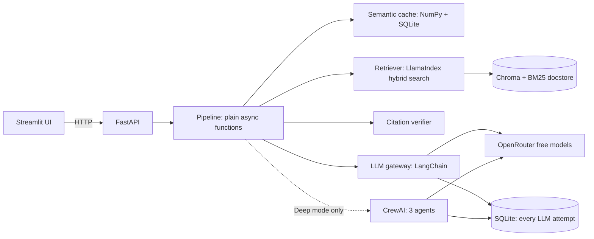
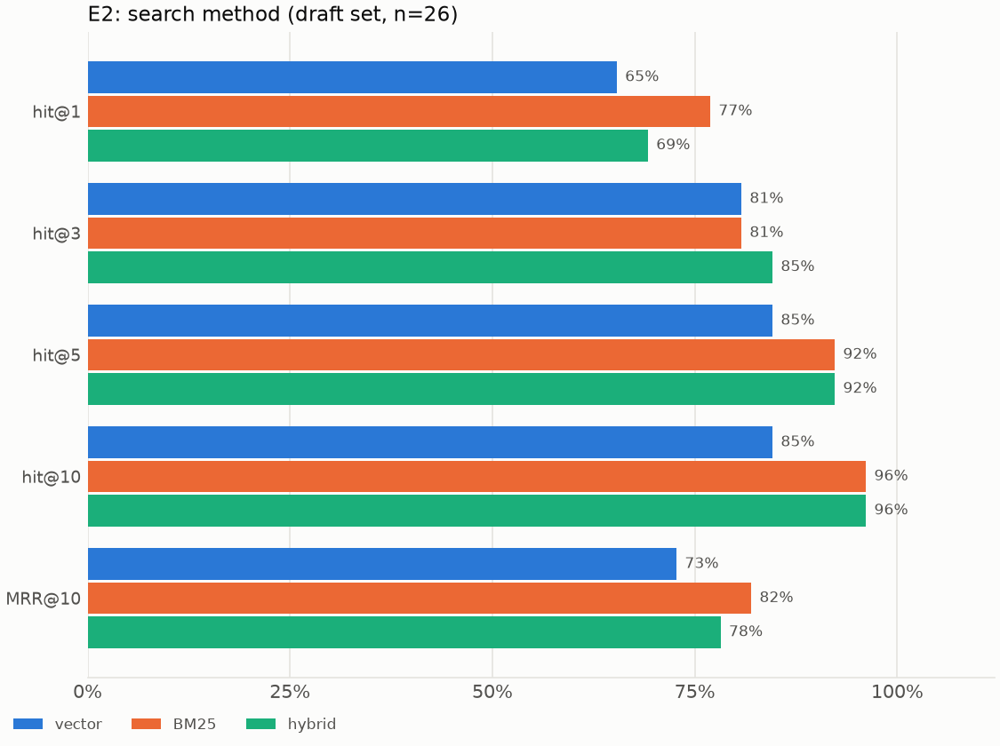

# CiteRAG

Ask questions about your own documents and get answers whose citations are checked by code, not trusted from the model. CiteRAG adds a semantic cache, image questions, an optional multi-agent Deep mode and an evaluation harness.

Python only: FastAPI backend, Streamlit frontend, OpenRouter free models, local embeddings. It runs on one machine for one person.

**Status:** every milestone is built, but the numbers are provisional. See [Results](#results-provisional) and [Limitations](#limitations).

## How it works



- **A question** is condensed if it is a follow-up, looked up in the cache, then answered from retrieved passages.
- **Citations are verified:** each quote is fuzzy-matched against its passage by code. A failure triggers one corrective retry, and any remaining doubt shows as a warning.
- **The cache** stores only fully verified answers, and any change to the corpus, answer model, prompt or retrieval settings invalidates it.
- **Document text is untrusted data.** It is escaped into a delimited block, and canary tests check that injected instructions are not followed.

## Quickstart

You need [uv](https://docs.astral.sh/uv/) and an [OpenRouter](https://openrouter.ai/) API key. The first run downloads PyTorch and the embedding model, which are large.

```bash
git clone <this repository> citerag
cd citerag
uv sync --extra dev
cp .env.example .env                       # then set OPENROUTER_API_KEY
uv run pytest                              # no network and no key needed
uv run python scripts/fetch_sample.py      # optional: the public demo documents
uv run citerag ingest data/sample          # local embeddings, zero LLM requests
uv run uvicorn citerag.api.main:app --port 8000
```

In a second terminal:

```bash
uv run streamlit run src/citerag/ui/app.py
```

Open http://localhost:8501, go to Chat and ask a question. Upload your own files on the Library page.

**Set `CACHE_ENABLED=false` in `.env` until you have run the threshold sweep:** the default `CACHE_THRESHOLD` of 0.92 is a placeholder, and it can serve a wrong answer for a similar question. See `docs/results/M6_test_guide.md`.

With Docker, the alternative is `docker compose up --build`. **The Docker files are untested:** the daemon was not running when they were written.

## Free-tier limits

The free tier allows 20 requests per minute and 50 per day, and every HTTP attempt counts, failed ones included. The app stops itself at `MAX_REQUESTS_PER_DAY` (default 40) and says when the next slot frees up. Check your count with `uv run citerag quota`.

| Action | LLM requests |
|---|---|
| Cache hit on a standalone question | 0 |
| Ingestion without captions, retrieval metrics, threshold sweep | 0 |
| Standard question | 1, up to 4 |
| Question with an image | 3, up to 5 |
| Deep mode | at least 3, usually 3 to 5 |
| Each document image captioned (opt-in) | 1 |

## Results (provisional)

**None of these is a final result.** All 43 golden items are drafts that no human has verified, and only one verdict exists, from a judge that is the same model as the answerer.

| Metric | Target | Now | Note |
|---|---|---|---|
| hit@5, hybrid | at least 85% | 24 of 26 (92%) | Provisional |
| Full coverage@5, `multi_chunk` | none set | 2 of 5, 4 of 5 with rerank | Five items only |
| Correct refusals | at least 90% | 7 of 7 | Provisional; measured at gate 0.30 |
| Injection canary leaks | 0 | 0 of 5 | Provisional |
| Faithfulness, correctness, citation validity | 90%, 75%, 95% | not measured | Needs an answerable run |
| Cache hit rate, request reduction | at least 30%, 25% | not measured | E6 needs labelled pairs and a live run |
| False-hit rate | at most 2% | not measured | E5 needs your labels |
| Deep vs standard | none set | not measured | E7 needs a live run |



Details are in `docs/results/`: `baseline.md`, `experiments_retrieval.md`, `M5_images.md` and one test guide per milestone from M6.

## Privacy

Documents, vectors, cache and logs stay on your machine. Questions, retrieved passages and images being captioned or analysed go to OpenRouter and to the provider serving the model. Provider retention differs, and your OpenRouter account has a separate privacy setting for free models that decides whether training providers may be used. Check that setting, use only documents you are comfortable sharing, and consider `OPENROUTER_DATA_COLLECTION=deny`, which may leave no free endpoint and show up as 503 errors.

Question text is stored locally in `data/logs/app.sqlite`. `uv run citerag logs purge --days 30` deletes older rows.

## Limitations

- **Quota shapes everything.** A full golden run takes days on 50 requests a day, so most experiments are unrun.
- **The judge grades its own model.** All four roles run on `nvidia/nemotron-3.5-super-vl:free`. Free models change often and vary in quality.
- **No crew has reached a real model.** Deep mode and the evaluation crews are tested against a fake server only. CrewAI parses output strictly, so a model that fences its JSON may fail there.
- **Gate:** the relevance gate cannot catch on-topic questions the documents do not answer, so refusing those is the model's job.
- **Citations check quotes, not reasoning.** A valid quote does not prove the sentence around it is right.
- **Cache guard:** it compares digits and a short list of negation words. "first" and "second", or "days" and "hours", pass it, so only the threshold stops them.
- **Single process.** Embedded Chroma allows one writer: stop the API before running `citerag ingest`, or use `--via-api`.
- **Not built:** progress events over SSE (`/v1/chat/stream`), Ragas, voice input, an API rate limit, multi-user auth.

## Learn more

`docs/PRD.md` says what the project does, `docs/ARCHITECTURE.md` says how, and `CLAUDE.md` holds the commands, working rules and every gotcha found so far. The security review is in `docs/results/security_checklist.md`.
