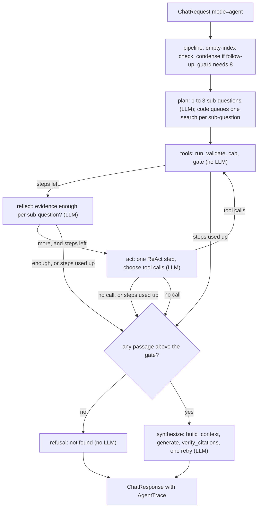

# CiteRAG Phase 3: Architecture (agent mode)

Status: **plan, not built.** Written 2026-11-07. Requirements and IDs are in `docs/PHASE3_PRD.md`. `docs/ARCHITECTURE.md` stays the
source for everything built in M0 to M8; this file adds to it. Reference code in its Appendix A stays untouched.

## 1. Verified facts this design rests on

Checked on 2026-11-07 against the installed packages and OpenRouter's public model list. No LLM request was made.

| Fact | How it was checked |
|---|---|
| `langgraph==1.2.20` is installed, MIT licence, required by `langchain` 1.4.9; depends on `langchain-core>=1.4.7,<2` | `importlib.metadata` |
| `mcp==1.30.0` is installed, MIT licence, required by `crewai` 1.15.36 | `importlib.metadata` |
| Adding both as direct dependencies changes no locked version | `uv add langgraph mcp --no-sync` on a scratch copy of `pyproject.toml` and `uv.lock`: 0 added, 0 changed |
| `StateGraph`, `START`, `END`, `add_conditional_edges`, `ainvoke(..., {"recursion_limit": n})`; a loop past the limit raises `langgraph.errors.GraphRecursionError` | A 1-node loop run against the installed package |
| `mcp.server.fastmcp.FastMCP`, `@server.tool()` with Pydantic `Field` limits and a Pydantic return type gives an `inputSchema` and an `outputSchema` | The installed SDK |
| `mcp.shared.memory.create_connected_server_and_client_session(server._mcp_server)` runs an in-process client; `call_tool` with `k=99` against `le=10` returns `isError=True` with the validation message | Run in-process |
| `FastMCP.run(transport="stdio")` is the default; it also offers `sse` and `streamable-http`, which this design does not use | `inspect.signature` |
| FastMCP logs `INFO Processing request of type ...` on every call | Seen in the run above. **M9 must prove these go to stderr**, or they corrupt the stdio stream |
| `nvidia/nemotron-3.5-super-vl:free` lists tools, structured outputs and `response_format` | `scripts/pick_free_models.py` |

## 2. Where the new code lives

```
src/citerag/
├─ tools/          framework-free: contracts.py (Pydantic args and results), library.py (list, search, read_page), render.py
├─ agent_graph/    the only place that imports langgraph: state.py, nodes.py, graph.py, routing.py, supervisor.py (M12)
├─ mcp_server/            the only place that imports the MCP SDK: server.py (FastMCP over stdio), backend.py (HTTP or local tools)
├─ llm/gateway.py  + tool_step(): native tool calling, with the JSON action fallback (LangChain stays in llm/)
├─ api/routers/    + tools.py: POST /v1/tools/{name}, read-only (decision 1)
├─ prompts/        + agent_plan.md, agent_act.md, agent_reflect.md (synthesis reuses answer.md)
└─ rag/pipeline.py + mode "agent": hands the request to agent_graph through a protocol, as Deep mode does with agents/
```

**Framework boundaries, extended (ADR-15, ADR-16):**

| Framework | Owns | Lives in | Must not |
|---|---|---|---|
| **LangGraph** | The agent `StateGraph`, routing, recursion limit, the M12 supervisor | `agent_graph/` | Call a model itself or build a LangChain client; return graph or LangChain objects; run in the standard or Deep path |
| **MCP SDK** | The stdio server and its tool registration; the in-process test client | `mcp_server/` | Hold tool logic (it calls `tools/`); open any transport but stdio; expose prompts or resources |
| **Tools** (no framework) | Argument validation, retrieval calls, caps, rendering | `tools/` | Import LangChain, LangGraph, LlamaIndex types, CrewAI or the MCP SDK |

`langgraph` and `mcp` were already importable before Phase 3, as transitive dependencies. A boundary test (as for CrewAI in M7)
fails if `langgraph` is imported outside `agent_graph/` or `mcp` outside `mcp_server/`.

## 3. The agent graph



**Planner-executor with ReAct and reflection.** `plan` decomposes the question once, and code then searches each sub-question
(planner-executor). `reflect` grades the evidence per sub-question and either stops or names what to search next. Only then does
`act`, one ReAct step, choose tool calls (`search_documents` or `read_page`, up to one per sub-question) or stop. The loop runs
`reflect`, `act`, `tools` until reflection says enough, `act` calls nothing, or the step budget runs out.

**Why the first search is code, not the model (M10 spike, 2026-11-07, 3 live requests on `nemotron-3.5-super-vl:free`).** Native
tool calls worked mechanically: valid arguments in 1.1 to 4.9 s. The choices were poor, though. Asked a two-part question with no
evidence, the model called `list_documents` instead of searching. Given evidence that answered both parts, it called
`list_documents` again instead of stopping. The JSON action came back empty. So the plan's sub-questions are searched by code, the
act step is offered only `search_documents` and `read_page`, and the document names go into its prompt.

**Each act step is stateless (ADR-20).** The step gets a fresh prompt with the evidence so far, rendered by `render_passages`, not
a growing list of LangChain tool messages. That keeps LangChain objects inside `llm/`, makes native tool calling and the JSON
fallback use the same prompt, and keeps the prompt within `CONTEXT_TOKEN_BUDGET`.

**Requests per question.** Plan 1, reflect 1, synthesize 1: **3**. One more round adds act and reflect: **5**.
`AGENT_MAX_STEPS=6` caps plan, act and reflect together: plan, reflect, act, reflect, act, reflect. Synthesis plus its one citation
retry brings the worst case to **8**, and a follow-up's condense step to 9. Each failed HTTP attempt inside a call adds 1, and the
guard counts it.

**Routing is plain Python** (`routing.py`): pure functions of the state, unit-tested without LangGraph. LangGraph's
`recursion_limit` (`AGENT_RECURSION_LIMIT=25`) only catches a routing bug. The worst legal path visits 10 nodes: plan, tools,
reflect, act, tools, reflect, act, tools, reflect, end.

## 4. State

Pydantic model in `agent_graph/state.py`. LangGraph accepts Pydantic state, and nothing in it is a framework object.

| Field | Type | Notes |
|---|---|---|
| `question` | `str` | Standalone question, after condense |
| `doc_ids` | `list[str] \| None` | Applied to every tool call (F-TOOL-7) |
| `request_id` | `str` | Every `llm_calls` row of the request carries it |
| `sub_questions` | `list[str]` | 1 to `AGENT_MAX_SUBQUESTIONS` |
| `hits` | `dict[str, ToolHit]` | By `chunk_id`, deduplicated, in the order found |
| `evidence` | `dict[int, list[str]]` | Sub-question index to the `chunk_id`s that reflection judged useful |
| `documents` | `list[str]` | Library names, listed by code once, for the act prompt |
| `pending` | `list[ToolCall]` | The plan's searches, then calls chosen by `act`; run by `tools` |
| `next_queries` | `list[str]` | Reflection's suggestions for the next `act` |
| `steps_used` | `int` | LLM calls of plan, act and reflect |
| `trace` | `AgentTrace` | Built as the graph runs |
| `stop_reason` | `Literal["enough", "no_more_calls", "step_limit", "no_evidence", "timeout"] \| None` | |

## 5. Contracts

**Tool contracts** (`tools/contracts.py`, public through MCP and `/v1/tools/*`, decision 1):

```python
class SearchArgs(BaseModel):
    model_config = ConfigDict(extra="forbid")
    query: str = Field(min_length=1, max_length=500)
    doc_ids: list[str] | None = Field(default=None, max_length=20)
    k: int = Field(default=5, ge=1, le=10)            # fixed in the contract, so MCP clients see the same bound

class ReadPageArgs(BaseModel):
    model_config = ConfigDict(extra="forbid")
    doc: str = Field(min_length=1, max_length=200)    # a doc_id or an exact stored doc_name, resolved via the manifest
    page: int = Field(ge=1, le=10_000)

class ListDocumentsArgs(BaseModel):
    model_config = ConfigDict(extra="forbid")

class ToolHit(BaseModel):
    chunk_id: str
    doc_id: str
    doc_name: str
    page: int | None
    kind: Literal["text", "image"]
    text: str                                          # capped; never shown to a model except through render_passages
    score: float | None = None

class ToolResult(BaseModel):
    tool: Literal["list_documents", "search_documents", "read_page"]
    ok: bool
    error: str | None = None                           # a typed message, F-TOOL-6; never a stack trace
    message: str = ""                                  # written by code, e.g. "no relevant passages"
    hits: list[ToolHit] = []
    documents: list[DocumentInfo] = []                 # list_documents only; existing schema
    top_similarity: float | None = None                # search only: the gate value
    truncated: bool = False
```

**Model-facing schemas** (`agent_graph/state.py`, minimal, rule 3):

```python
class Plan(BaseModel):
    sub_questions: list[str] = Field(min_length=1, max_length=3)

class ToolCall(BaseModel):
    name: Literal["list_documents", "search_documents", "read_page"]
    args: dict[str, Any]                               # validated against the tool's args model before it runs

class AgentAction(BaseModel):                         # the JSON fallback for a model without working tool calls
    calls: list[ToolCall] = Field(default_factory=list, max_length=3)
    done: bool = False

class Reflection(BaseModel):
    enough: list[bool]                                 # one per sub-question
    next_queries: list[str] = Field(default_factory=list, max_length=3)
```

**Trace** (on `ChatResponse.trace`, approved):

```python
class AgentStep(BaseModel):
    node: Literal["plan", "act", "tools", "reflect", "synthesize"]
    tool: str | None = None
    args: dict[str, Any] | None = None                 # validated arguments only: a query is model text, shown as plain text
    hits: list[str] = []                               # "doc p3" references, never passage text
    note: str = ""                                     # e.g. "2 of 3 sub-questions answered"; written by code, not the model
    llm_requests: int = 0
    latency_ms: int = 0

class AgentTrace(BaseModel):
    sub_questions: list[str]
    steps: list[AgentStep]
    stop_reason: str
    llm_requests: int
    method: Literal["tools", "json"]
```

`LatencyMs` is unchanged. Plan, act and reflect time sits in the trace, tool time in `retrieve`, and synthesis in `generate`.

## 6. Gateway: tool calling

`LLMGateway.tool_step(role, system, user, tools: list[type[BaseModel]], request_id) -> StructuredResult[AgentAction]` is new.
`FakeGateway` gets the same method.

1. **Native:** `ChatOpenAI.bind_tools([...], tool_choice="auto")` with one function spec per tool, built from plain JSON schemas
   (`tools.contracts.tool_specs`). `raw.tool_calls` becomes an `AgentAction`; no tool call means `done=True`. A bad native tool
   call never switches the model's structured-output method for other schemas.
2. **Fallback:** if the reply has malformed tool calls, or a 400 names `tools` or `tool_choice`, the gateway switches that model to
   `structured_call(AgentAction)` with `parse_model`. That is the same "switch once per model" rule as json_schema to tools today
   (ADR-14), and it is logged. `AGENT_ACTION_METHOD=auto|tools|json` can force either path.
3. Every attempt is one `llm_calls` row with role `agent_act`, so the limiter, the guard and retries work as they do now.

Arguments from either path are validated against the tool's args model in `tools/`. A failed validation becomes a `ToolResult`
with `ok=false`, which the next `act` step sees. It is never retried silently.

## 7. Safety (roadmap 3.2: sandboxing and tool safety)

| Threat | Control |
|---|---|
| A tool changes data or reaches out | Only three read-only tools exist, with no write, delete, shell, file-path or network capability. Tools run in-process with no sandbox to escape, because there is nothing to execute |
| Bad or oversized arguments | Pydantic with `extra="forbid"`, length and range limits; `doc` resolves only through the manifest |
| A huge result floods the context | `k` at most 10, `AGENT_TOOL_RESULT_CHARS` per call, `AGENT_CONTEXT_MAX_PASSAGES` (8) and `CONTEXT_TOKEN_BUDGET` at synthesis |
| Injected text in a passage | `render_passages` escaping, the untrusted-data rule in every agent prompt, and code-written notes only in the trace. Canary checks run on the answer **and** on every tool argument (F-GRF-9) |
| Tool hijacking: a passage steers the next search | No exfiltration path exists, so the harm is wasted requests and a wrong answer. The step limit bounds it, and the trace shows it |
| Runaway loop or cost | `AGENT_MAX_STEPS`, `recursion_limit`, `AGENT_TIMEOUT_S`, the guard pre-check for 8, and the per-provider limiter |
| MCP exposure | stdio only, no HTTP transport, no prompts or resources; stdout reserved for JSON-RPC; HTTP mode sends `X-API-Key` when `CITERAG_API_KEY` is set |
| Two processes writing Chroma | The MCP server calls the API by default (ADR-21); `--local` is for when the API is stopped |

## 8. Configuration (decision 5)

| Key | Default | Meaning |
|---|---|---|
| `AGENT_ENABLED` | `true` | Off: `mode="agent"` returns 400 |
| `AGENT_MAX_SUBQUESTIONS` | `3` | Upper bound in `Plan` |
| `AGENT_MAX_STEPS` | `6` | LLM calls of plan, act and reflect; synthesis is outside it |
| `AGENT_RECURSION_LIMIT` | `25` | LangGraph backstop |
| `AGENT_TIMEOUT_S` | `240` | Whole agent request |
| `AGENT_TOOL_RESULT_CHARS` | `6000` | Per tool call |
| `AGENT_CONTEXT_MAX_PASSAGES` | `8` | Passed to `build_context` at synthesis |
| `AGENT_ACTION_METHOD` | `auto` | `auto`, `tools` or `json` |
| `MCP_MODE` | `api` | `api` (HTTP to the backend) or `local` (opens the index) |

Roles stay as they are: `plan` and `reflect` use `fast`, `act` and `synthesize` use `strong`. No new model key unless the spike says
the act step needs another model.

## 9. MCP server

`citerag mcp [--local]` builds a `FastMCP("citerag")` with three `@server.tool()` functions whose parameters are the args models'
fields and whose return type is `ToolResult`. Each function calls a `ToolBackend`:

| Backend | When | How |
|---|---|---|
| `HttpBackend` (default) | The API is running | `POST {API_BASE_URL}/v1/tools/{name}` with the args model; the API runs the same `tools/` code under its index lock |
| `LocalBackend` | `--local` or `MCP_MODE=local`, API stopped | Opens the index in-process with `open_store` and `HybridRetriever` |

Logging is set to stderr before the server starts. An example MCP client configuration goes into the M9 test guide, with
`command: uv`, `args: ["run", "citerag", "mcp"]` and `cwd` set to the repo.

## 10. Tool-calling model and how it will be checked

Chosen: `nvidia/nemotron-3.5-super-vl:free` for `act` (decision 6). The M10 spike below ran on 2026-11-07 with retries off, 3
requests in total. Results: 1 passed mechanically but chose `list_documents`; 2 failed (it did not stop); 3 returned an empty
action. Native tool calls stay the default (`AGENT_ACTION_METHOD=auto`), with the design changes in section 3.

| # | Request | Pass |
|---|---|---|
| 1 | Native: three tools, `tool_choice="auto"`, a two-part question | At least one `tool_calls` entry whose arguments validate against `SearchArgs` |
| 2 | Native: evidence already enough | No tool call, or `done`; no invented tool name |
| 3 | JSON fallback: the same as 1 through `structured_call(AgentAction)` | A valid `AgentAction` |

At most 3 requests. A failure on 1 or 2 with a pass on 3 means `AGENT_ACTION_METHOD=json` becomes the default. Record latency and
the served model, and add the result to the gotchas.

## 11. Evaluation E8

- **Configs:** `configs/experiments/e8_standard.yaml`, `e8_deep.yaml`, `e8_agent.yaml`. `Experiment.mode` gains `"agent"`.
- **Runner:** `WORST_AGENT_REQUESTS = 8` for `--max-requests`. The agent passes the chunks that reached synthesis to `Deps.observe`,
  so `ItemRecord.retrieved` means "what the generator saw" in every mode, and no eval schema changes.
- **Context coverage:** `full_coverage_at_k(retrieved, gold, k=len(retrieved))` per `multi_chunk` item, reported next to the offline
  hybrid figure. It is computed from `items.jsonl` by the E8 report, not stored in `RunSummary`.
- **Compare:** `citerag eval compare` takes two or more runs. A new `citerag eval report-e8 RUN...` writes `docs/results/E8_modes.md`
  and one chart (grouped bars, one scale per panel).
- **Commands, run only on approval:**

```bash
uv run citerag eval run --golden eval/golden/golden.jsonl --require-verified --config configs/experiments/e8_agent.yaml --skip-type image --max-requests 30
uv run citerag eval run --golden eval/golden/golden.jsonl --require-verified --config configs/experiments/e8_agent.yaml --skip-type image --resume <run_id> --max-requests 30
uv run citerag eval report-e8 <standard_run> <deep_run> <agent_run>
```

Cost and caps are in PHASE3_PRD section 9.

## 12. M12: supervisor and workers (optional)

A second graph in `agent_graph/supervisor.py`. The supervisor (`fast`) routes to a researcher worker (the act, tools, reflect loop
above) or a writer worker (synthesis), and ends when the writer has a verified answer. Handoffs pass the state, never free text.
Expected cost: the single agent's plus 2 to 3 supervisor calls, so 6 to 10, capped at 12.

The comparison runs supervisor, single agent and CrewAI Deep mode on the same items. To save requests, use the 5 `multi_chunk`
items plus 10 answerable ones: about 15 × (8 + 5 + 4) + 45 judge calls, or about 300. The write-up answers one question: on these
items, does the extra coordination buy coverage or correctness worth its requests and seconds?

## 13. Test plan

| Layer | Cases | Network |
|---|---|---|
| Unit: `tools/` | Args reject extra fields, long queries, `k` out of range, page 0; unknown `doc`; caps and `truncated`; gate returns "no relevant passages"; `doc_ids` filter; results escaped through `render_passages` | none |
| Unit: `routing.py` | Every edge: tool calls, no calls, enough, more with steps left, steps used up, no evidence | none |
| Unit: prompts | The three agent prompts have a `version` and the untrusted-data rule | none |
| Integration: graph on `FakeGateway` | Happy path in 4 calls; one extra round in 6; step limit forces synthesis; `GraphRecursionError` mapped to a typed error; guard with fewer than 8 left refuses before any call; trace steps match `llm_calls` rows; canary passage escaped and absent from tool arguments; no-evidence refusal without synthesis; the cache untouched | none |
| Integration: gateway `tool_step` on the fake OpenAI server | Native `tool_calls` parsed; malformed tool call switches to JSON once; 429 inside the step retried and counted | none (`FakeOpenRouter` needs a queued tool-call reply, which it already supports) |
| Integration: API | `mode="agent"` returns a trace; image with agent is 400; `AGENT_ENABLED=false` is 400; `/v1/tools/*` validation errors are 400 with `ErrorResponse` | none |
| Integration: MCP | In-process client: 3 tools listed with schemas, each called, bad arguments give `isError`, caps hold; a subprocess `citerag mcp --local` completes `initialize` and `tools/list` over real stdio, with nothing but JSON-RPC on stdout | none |
| UI (`AppTest`) | Mode selector, cost warning, trace expander with plan, tool calls and requests | none |
| Boundary | `langgraph` only in `agent_graph/`, `mcp` only in `mcp_server/`, `tools/` imports no framework | none |
| Live (`-m live`, on approval) | The section 10 spike; one agent question | at most 11 requests |

## 14. Architecture decisions

| # | Decision | Why | Alternatives | Revisit when |
|---|---|---|---|---|
| ADR-15 | LangGraph for Agent mode only, in `agent_graph/` | The roadmap asks for it; explicit state and a recursion limit suit a tool loop. The standard path stays plain functions (ADR-10) | Hand-written loop; LangGraph for every mode | The standard path needs loops or tools |
| ADR-16 | MCP SDK only in `mcp_server/`, stdio only | Smallest attack surface; the server is a thin adapter over `tools/` | HTTP or SSE transport | A remote client is needed, with auth |
| ADR-17 | Tools are a framework-free package shared by the graph, the API and MCP | One implementation of validation, caps and gating | Tools defined inside LangGraph or MCP | Never |
| ADR-18 | Agent mode bypasses the cache | The trace and cost are what is being measured; agent answers depend on a search path | Cache the final answer | Agent mode becomes a default |
| ADR-19 | Own step counter as the real limit; `recursion_limit` only as a backstop | A step counted in LLM calls maps to quota; graph-node visits do not | `recursion_limit` alone | Never |
| ADR-20 | Stateless act steps with a fresh prompt, native tool calls first, JSON action fallback | Keeps LangChain messages inside `llm/`; both methods share one prompt; free models vary | Multi-turn tool-message history | A model needs the history to call tools well |
| ADR-21 | The MCP server calls the API by default | Chroma allows one writer, and users keep the API running | MCP opens the index | Chroma runs in server mode (ADR-12) |
