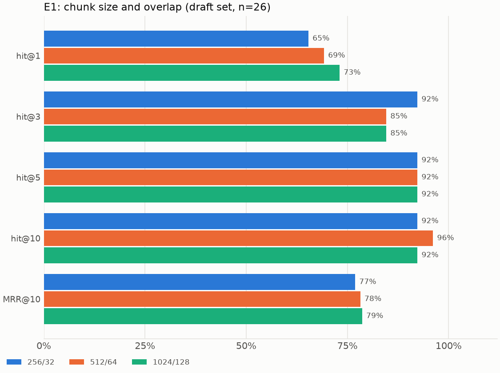
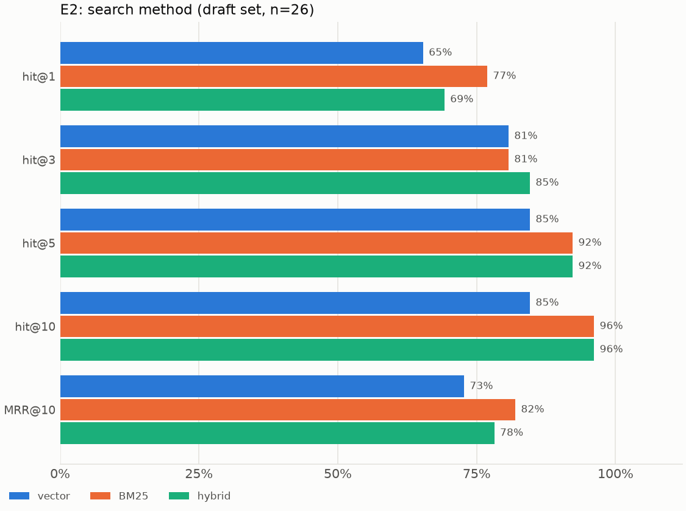
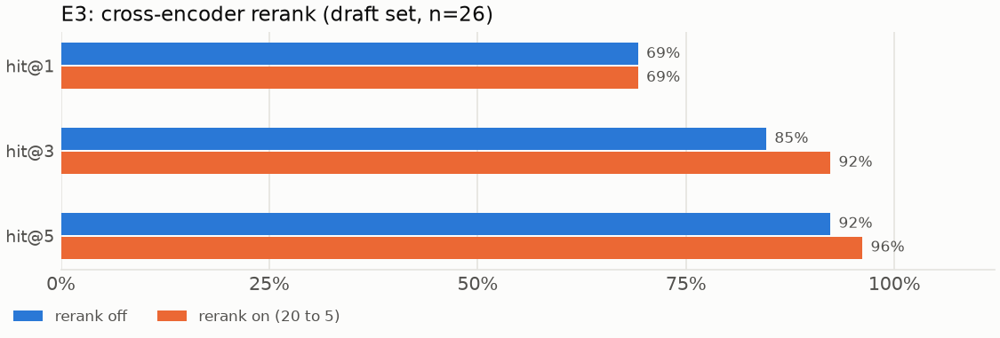

# Retrieval experiments E1 to E3 (provisional)

**PROVISIONAL.** Date: 2026-11-06. LLM requests: 0. All three use the 26 answerable and multi_chunk items in `eval/golden/candidates.jsonl`, which no human has verified and which were written from the text they point to. One item is 3.8 points here, so a one-item difference is noise. Rerun on the verified set before deciding anything.

```bash
uv run citerag ingest data/sample --config configs/experiments/e1_chunk_256.yaml
uv run citerag ingest eval/fixtures/poisoned --config configs/experiments/e1_chunk_256.yaml
uv run citerag eval run --golden eval/golden/candidates.jsonl --config configs/experiments/e1_chunk_256.yaml --offline
```

## E1: chunk size



| Metric | 256/32 | 512/64 | 1024/128 |
|---|---|---|---|
| hit@1 | 17/26 (65%) | 18/26 (69%) | 19/26 (73%) |
| hit@3 | 24/26 (92%) | 22/26 (85%) | 22/26 (85%) |
| hit@5 | 24/26 (92%) | 24/26 (92%) | 24/26 (92%) |
| hit@10 | 24/26 (92%) | 25/26 (96%) | 24/26 (92%) |
| MRR@10 | 0.769 | 0.782 | 0.787 |
| multi_chunk full coverage@5 | 2/5 | 2/5 | 3/5 |

**Conclusion:** no size wins. hit@5 is the same for all three, and the other gaps are one or two items. Keep 512/64. Faithfulness and tokens per question, the rest of this experiment, need the judge. Scoring by page also favours larger chunks, which cover more of a page.

## E2: does hybrid help?



| Metric | Vector | BM25 | Hybrid |
|---|---|---|---|
| hit@1 | 17/26 (65%) | 20/26 (77%) | 18/26 (69%) |
| hit@3 | 21/26 (81%) | 21/26 (81%) | 22/26 (85%) |
| hit@5 | 22/26 (85%) | 24/26 (92%) | 24/26 (92%) |
| hit@10 | 22/26 (85%) | 25/26 (96%) | 25/26 (96%) |
| MRR@10 | 0.728 | 0.820 | 0.782 |
| multi_chunk full coverage@5 | 3/5 | 3/5 | 2/5 |

**Conclusion:** hybrid beats vector alone by 2 items at hit@5. It does not beat BM25 alone: they tie at hit@5 and hit@10, and BM25 leads on hit@1 and MRR. Treat that with care, because draft questions copy document wording, which suits a keyword search. Paraphrased questions on the verified set should show whether hybrid earns its place. Keep hybrid until then.

## E3: does rerank help?



| Metric | Off | On (20 to 5) |
|---|---|---|
| hit@1 | 18/26 (69%) | 18/26 (69%) |
| hit@3 | 22/26 (85%) | 24/26 (92%) |
| hit@5 | 24/26 (92%) | 25/26 (96%) |
| multi_chunk full coverage@5 | 2/5 | 4/5 |

MRR is 0.796 at 5 with rerank on, and 0.782 at 10 with it off, so the two are not directly comparable.

**Conclusion:** rerank adds 1 item at hit@5, which is 3.8 points and meets the 3-point bar in OPEN-2, but one item is exactly what this set cannot separate from noise. Full coverage@5 goes from 2 of 5 to 4 of 5, the strongest case for rerank so far, on only five items. The latency half of OPEN-2 was not measured here. `RERANK_ENABLED` stays false, and OPEN-2 stays open.

## E4: how much context?

Not run. `configs/experiments/e4_context_{3,5,8}.yaml` are ready, but its metrics are faithfulness and correctness, which need the judge.
